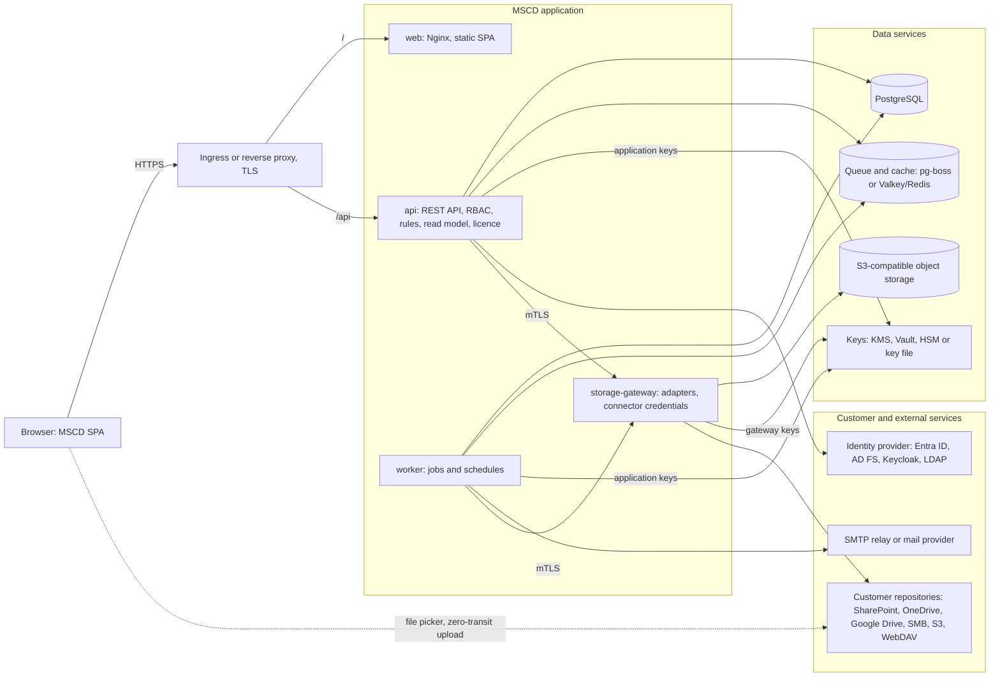
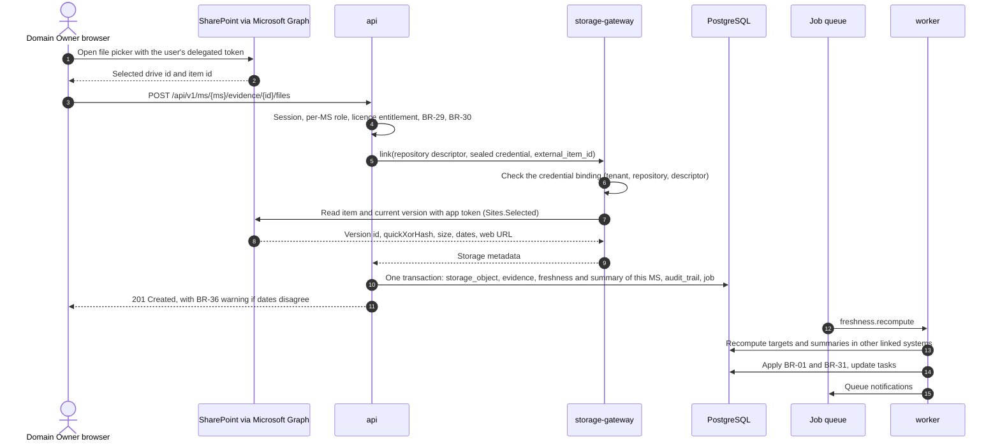
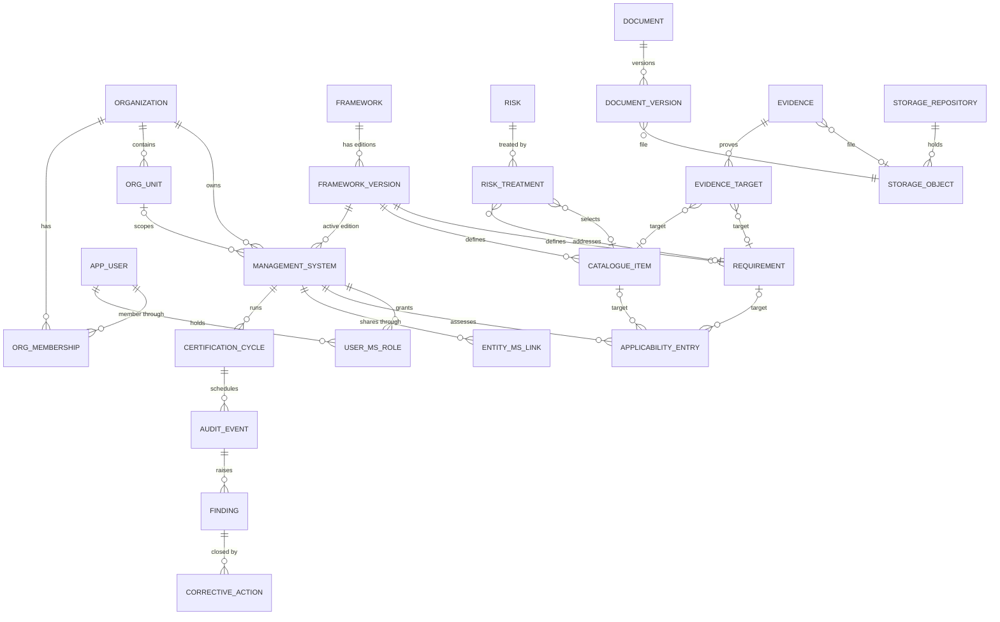
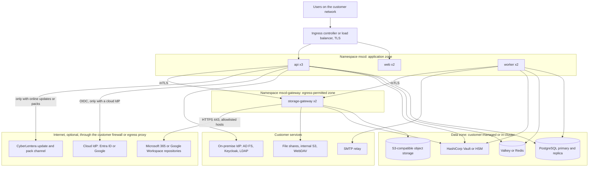

# MSCD Architecture and Tech Stack

| | |
|---|---|
| Product | MSCD (Management System Compliance Dashboard) by CyberLentera, mscd.cyberlentera.com |
| Status | Target architecture, draft for engineering and customer review |
| References | TS-MSCD-01 v2.4 (TS), PRD-MSCD-01 v2.4 (PRD), Technical Proposal v1.0 |
| Notation | "TS 2.3" means section 2.3 of the technical specification |
| Readers | Engineering lead, customer solution and security architects |

## Contents

1. [Decisions at a glance](#1-decisions-at-a-glance)
2. [Current state](#2-current-state)
3. [Architecture principles](#3-architecture-principles)
4. [Tech stack](#4-tech-stack)
5. [Components](#5-components)
6. [Key flow: linking evidence from SharePoint](#6-key-flow-linking-evidence-from-sharepoint)
7. [Background jobs](#7-background-jobs)
8. [Data model](#8-data-model)
9. [Multi-tenancy](#9-multi-tenancy)
10. [Security model](#10-security-model)
11. [Deployment](#11-deployment)
12. [Observability and operations](#12-observability-and-operations)
13. [API style](#13-api-style)
14. [Front end](#14-front-end)
15. [Repository layout](#15-repository-layout)
16. [Testing and delivery](#16-testing-and-delivery)
17. [Roadmap](#17-roadmap)
18. [Open decisions](#18-open-decisions)

## 1. Decisions at a glance

- **One TypeScript code base.** React front end, NestJS back end on Node.js LTS, shared types, one monorepo.
- **Two container images per release.** `mscd-web` (Nginx serving the built SPA) and `mscd-server` (one image with the run modes `api`, `worker` and `storage-gateway`, plus one-off `migrate` and `export` commands).
- **PostgreSQL for all structured data and the audit trail.** SaaS gives each organisation its own schema, with Row-Level Security on `organization_id` as a second layer. On-premise runs one organisation per database.
- **Jobs behind one interface.** pg-boss on PostgreSQL for small installs, BullMQ on Valkey or Redis for medium and large installs.
- **Files stay where the customer wants them.** S3-compatible object storage for the Managed Vault, or the customer's own repository. Only `storage-gateway` talks to storage providers. Connector credentials are sealed with a key that only the gateway can use (section 10.4).
- **Same signed images for SaaS and on-premise.** Differences come from the deployment profile (TS 2.4). Code never branches on the mode name.
- **On-premise packaging.** Helm chart (primary), Docker Compose (small installs and PoC), offline air-gapped bundle with a signed `SHA256SUMS` file. Release 1.0.0 already ships this package for the web app; section 11.9 lists what the full platform adds.
- **Server-side derivation.** Every status and count comes from one server function per concept (TS 9.6). The browser renders derived values and never recomputes them.

## 2. Current state

The repository holds a working front end in `app/`, built from the Claude Design handoff. It runs fully in the browser on fictional sample data. There is no back end yet. An on-premise package for this front end (container image, Helm chart, Compose file, installer scripts and offline bundle) lives in `deploy/`, with the customer guide in [INSTALL-ONPREM.md](INSTALL-ONPREM.md).

| Area | Today | Target |
|---|---|---|
| Stack | React 18.3, Vite 6.4, plain JS and JSX | React 18, TypeScript, Vite |
| Structure | One controller class (`src/MscdApp.jsx`) holds state, derivations and actions; `renderVals()` returns a flat view model | Route components with typed hooks per screen |
| Views | 18 view components, including the root `AppView`, generated from `project/MSCD Mockup.dc.html` by `scripts/convert-template.mjs` | Typed components owned by the team after design sign-off |
| Data | `src/MscdApp.jsx` defines 3 sample organisations. `src/data/mscd-data.js` holds 4 management systems (ISMS, QMS, BCMS, ABMS), people, 4 personas, EN and ID strings and derivation helpers | REST API through TanStack Query; demos run on a seeded server (section 14.1) |
| Navigation | 14 screens selected through component state; no URL routes | React Router with a deep link for every screen and drill-down |
| Changes | Mark complete, reassign, link file and similar actions are in-memory overrides, lost on reload | Server mutations recorded in the audit trail |
| Status logic | Freshness, chain status and "After audit" computed in the browser | Computed on the server (TS 9.1) |
| Deployment mode | Set per sample organisation, switched with a UI toggle or with `?deploy=saas` or `?deploy=onprem`; the UI checks the mode name | UI reads capability flags from `GET /api/v1/system/profile` |
| Fonts | IBM Plex self-hosted; Google Fonts link for optional alternative pairings | All fonts self-hosted; no third-party origins, which air-gapped sites and a strict CSP need |
| Packaging | `app/Dockerfile` builds `cyberlentera/mscd-web` (unprivileged Nginx, HTTP on 8080, HTTPS on 8443). `deploy/helm/mscd-web` chart, `deploy/compose` file, and `install.sh`, `upgrade.sh`, `uninstall.sh` and `build-bundle.sh` in `deploy/scripts`. The offline bundle `mscd-onprem-1.0.0.tar.gz` carries the image as a `docker save` archive and a `SHA256SUMS` file signed with openssl | Two images, one `mscd` chart and one bundle for the full platform (section 11.9) |
| Tests | Playwright 1.56: 205 tests in 18 feature spec files in `app/e2e/` | Unit, integration, adapter contract and E2E tests in both deployment profiles |

Worth keeping as the product grows:

- **The view-model boundary.** Views read one prepared object, so switching from sample data to API data touches the controller and leaves the views alone.
- **The generated views.** They keep the UI faithful to the design while the design still changes.
- **Display settings in the URL** (`drill`, `density`, `layout`, `font`, `lang`, `theme`). They become saved user preferences that the URL can still override.
- **The Tera in-app guide**, as static content in the web bundle.

## 3. Architecture principles

| Principle | What it means in practice |
|---|---|
| One release artifact for both modes (PRD 10) | Same images and code paths; CI installs a SaaS profile and an on-premise profile on every commit (TS 10.1) |
| Configuration decides behaviour (TS 1.1, 2.4) | Code reads capabilities such as `license.validation` or `updates.channel` |
| One derivation per number (TS 9.6) | Derivations live in one server module; a snapshot test fails the build when modules disagree |
| No silent fallback (BR-29) | An unreachable repository rejects new files with a clear message; files are never diverted to the Managed Vault |
| One path to files | `storage-gateway` is the only component that talks to file repositories and holds their credentials, so it is the only component that needs egress for repository connectors. Section 10.6 lists the other outbound cases |
| Nothing is physically deleted (TS 1.1) | Soft delete everywhere; append-only audit trail; physical purge only for verified SaaS offboarding |
| Offline by default on-premise | Licence, Framework Packs and updates verify locally; no runtime calls to CyberLentera |
| Reads never wait on external repositories (TS 4.8, 9.5) | Integrity and freshness come from stored columns that background jobs keep current |

## 4. Tech stack

| Layer | Choice | Reason |
|---|---|---|
| Web UI | React 18, TypeScript, Vite | Continues the current code base; typed view models |
| Server state | TanStack Query | Caching, retries and optimistic updates for drill-down actions |
| Routing | React Router | Deep links to every screen, filter and open record |
| UI text | react-i18next with EN and ID catalogues; framework labels from the pack via the API | PRD 12 localisation; TS 3.3 label dictionary |
| Back end | Node.js LTS, TypeScript, NestJS (Fastify adapter) as a modular monolith | One language end to end; NestJS modules map to spec components; Fastify streams multipart uploads without temp files |
| Contracts | zod schemas in `packages/shared`; OpenAPI 3.1 generated from them; typed client for the web app | One definition for validation, docs and client types |
| Database | PostgreSQL 15 or later (TS 2.1); 16 as the recommended reference | RLS, recursive CTEs, full-text search; offered by every major managed service |
| Query layer | Kysely with versioned SQL migrations | Type-safe SQL; `withRecursive` for the Golden Thread query (TS 4.8); migrations that customer DBAs can read |
| Jobs | pg-boss (small), BullMQ on Valkey or Redis 7 (medium and large) | TS 2.1 allows both; one `JobQueue` interface with two drivers |
| Object storage | S3 API through AWS SDK v3 | Works with cloud S3 and any S3-compatible store on-premise |
| Identity | OIDC (`openid-client`), SAML 2.0 (`@node-saml/node-saml`), LDAP (`ldapts`), local accounts with argon2id and TOTP or WebAuthn MFA | TS 2.4 `identity.providers` |
| Keys and secrets | `KeyProvider` interface with drivers for cloud KMS, HashiCorp Vault Transit, PKCS#11 HSM (vendor library mounted at runtime, section 10.3) and encrypted key file | TS 2.4 `kms.provider` |
| Search | PostgreSQL full-text search and `pg_trgm`; text extraction for Managed Vault files in `storage-gateway` (pdfjs-dist, mammoth, exceljs) | PRD 11.5; no extra search engine to run on-premise (section 8.5) |
| Repository adapters | Microsoft Graph SDK with `@azure/identity`; Google Drive API v3; AWS SDK; WebDAV client; SMB through a mounted share | TS 5.2; all inside `storage-gateway` |
| Browser pickers | MSAL.js with the OneDrive and SharePoint File Picker; Google Picker | Link and zero-transit modes (TS 5.3) |
| Mail | Nodemailer over SMTP (on-premise); provider API (SaaS) | TS 2.4 `mail.transport` |
| Reports | pdf-lib for evidence pack manifests and review packs; CSV export | Keeps a headless browser out of the server image |
| Observability | OpenTelemetry SDK, Prometheus metrics, pino JSON logs | Standard tooling customers already run |
| Packaging | Helm 3 chart, Docker Compose v2, offline bundle with install, upgrade and uninstall scripts | TS 2.3 on-premise variants |
| Supply chain | `SHA256SUMS` signed with the release key and verified with openssl; cosign signatures on registry images; Syft SBOM (SPDX); Trivy or Grype scans | Verifiable releases, including air-gapped (section 11.9) |
| CI | GitHub Actions | Builds, tests, signs and publishes every release |
| Tests | Vitest, Testcontainers, Playwright, k6 | Unit, integration, E2E, load |

### 4.1 Lifecycle and licensing notes

| Topic | Issue | Recommendation |
|---|---|---|
| Node.js version | Node.js 22 reaches end of life on 30 April 2027 | Build the server image on Node.js 24 LTS (supported to April 2028) and plan each LTS move in the roadmap. Node 22 is fine for local development today |
| PostgreSQL version | The spec minimum, PostgreSQL 15, leaves community support in November 2027. PostgreSQL 18 has been generally available since September 2025, so new customer databases often run it | Recommended reference 16; CI tests 15, 16, 17 and 18, and adds 19 once it is generally available; drop 15 in the first release after its end of life |
| Redis licence | Redis 7.4 and later ship under source-available licences (Redis 8 adds AGPLv3) | Bundle Valkey (BSD licence, Redis-compatible) when MSCD ships the queue server; accept a customer's own Redis 7 or Valkey |
| MinIO | MinIO is AGPLv3, and in 2025 it stopped publishing free prebuilt community images | MSCD uses only the S3 API. Prefer the customer's existing S3-compatible storage for production. Pick the bundled S3 server for Compose and PoC after a licence review |
| Bitnami charts and images | The free Bitnami catalogue was cut back in 2025 | Do not depend on Bitnami. Use the CloudNativePG operator when PostgreSQL must run in the cluster |
| Keycloak | The spec expects the customer's own IdP and lists LDAP as a native provider (TS 2.4) | MSCD connects directly to OIDC, SAML and LDAP. Keycloak is an optional bundled broker for customers without an IdP |
| On-premise tenancy | TS 2.4 sets `tenancy.isolation: database` for on-premise | One organisation per database on-premise. Same schema layout, `organization_id` and RLS as SaaS, so the code path is identical |

## 5. Components



| Component | Responsibility | Technology | Scaling |
|---|---|---|---|
| web | Serves the SPA and static assets; injects runtime config at start, so one image fits every customer domain | `mscd-web`: unprivileged Nginx with the Vite build | Horizontal, stateless |
| api | REST API, sessions, RBAC, state machines, business rules, read model, licence checks | `mscd-server api` | Horizontal, stateless |
| worker | Freshness engine, link health checks, notifications, evidence packs, imports, summaries, drift detection | `mscd-server worker` | Horizontal per queue |
| storage-gateway | Only component that talks to storage providers; runs adapters; seals and opens connector credentials; encrypts Managed Vault objects; extracts text for search | `mscd-server storage-gateway` | Horizontal; can run in a separate, egress-permitted network zone |
| database | Structured data, audit trail, summary tables | PostgreSQL 15 or later | Primary and replica |
| queue and cache | Job queues, schedules, sessions, rate limits | pg-boss on PostgreSQL, or BullMQ on Valkey or Redis 7 | Primary and replica |
| object storage | Managed Vault, evidence pack artefacts, imports | S3-compatible | By volume |
| secrets and keys | Wrapping keys for application keys and gateway keys (section 10.3) | Cloud KMS (SaaS); Vault, HSM or key file (on-premise) | Customer or cloud service |
| license-service | Licence signature check and entitlements | Module inside api; offline Ed25519 verification on-premise, platform entitlement registry in SaaS (section 10.8) | Scales with api |

### 5.1 Server run modes

One image, one code base. The run mode decides which NestJS modules load.

| Command | Loads | Notes |
|---|---|---|
| `mscd-server api` | All business modules, storage client | Public HTTP API behind the ingress |
| `mscd-server worker` | Jobs, rules, read model, notifications, storage client | `--queues` limits a deployment to selected queues |
| `mscd-server storage-gateway` | Storage adapters, key provider, text extraction | Internal mTLS API only; no database credentials; the only process that can use the gateway keys |
| `mscd-server migrate` | Migrations; installs the Framework Packs shipped with the release, connected as `mscd_pack_installer` | Runs once per install or upgrade (Helm hook or Compose init container). `--dry-run` prints the SQL without applying it |
| `mscd-server export` | Read access to one tenant, storage client | Full tenant export in open formats (PRD 10.2) |

### 5.2 Server modules

| Module | Contents |
|---|---|
| platform | Deployment profile loader, capability flags, health, metrics |
| identity | Local accounts, MFA, OIDC, SAML, LDAP, sessions |
| tenancy | Organisation resolution, schema routing, RLS session settings |
| authz | Per-MS roles, permission matrix (TS 7.3), separation of duties (TS 7.4) |
| license | Ed25519 verification, entitlements, read-only mode (BR-37) |
| framework-engine | Pack validation and install, labels, mappings, edition transition (TS 3) |
| registers | Context, risk, treatment, applicability, documents, evidence, metrics, findings, reviews, cycles, framework-specific entities |
| rules | State machines (TS 6) and business rules BR-01 to BR-50, activated per framework from `rules.json` |
| read-model | Derivation functions, per-MS summary tables, drill-down endpoints (TS 9) |
| storage | Storage interface (TS 5.1), routing rules, gateway client, upload intents |
| jobs | Queue interface, schedules, job handlers |
| notifications | Email, in-app, reminders with throttling (BR-50) |
| audit-trail | Append-only writer, export |
| ops | Operations Console API, diagnostic export |

### 5.3 Internal communication

- `api` and `worker` call `storage-gateway` over HTTPS with mutual TLS. Certificates come from cert-manager when the cluster has it, otherwise from an internal CA the installer generates.
- `storage-gateway` has no database access. Callers pass the repository descriptor and the sealed credential. The gateway checks that the credential was sealed for that tenant and descriptor before it opens it (section 10.4). A compromised api pod cannot read connector secrets or reuse them against another site, and the gateway can sit alone in an egress-permitted zone for repository traffic (TS 2.1).
- `api` and `worker` share work only through the database and the job queue.
- Pass-through uploads stream from the browser through `api` to `storage-gateway` to the repository. Nothing is written to local disk, except an encrypted temp file for very large uploads that is deleted at once (TS 5.3).

## 6. Key flow: linking evidence from SharePoint

A Domain Owner links an existing file from the SharePoint compliance library as evidence for a control (Link mode). The freshness engine then updates every control and requirement that the evidence supports.



### 6.1 Steps

1. The browser opens the SharePoint file picker with the user's delegated token (MSAL.js). In Link mode, file content never passes through MSCD.
2. The browser sends the drive id, item id and `produced_at` to the api.
3. The api checks the session, the user's role in that management system (a Domain Owner may update own evidence), the `m365` licence entitlement, repository health (BR-29) and repository ownership (BR-30 warns on a personal OneDrive). The file must sit in a registered repository (section 6.5).
4. The api asks `storage-gateway` to `link` the item, passing the repository descriptor and the sealed credential.
5. The gateway checks the credential binding, then reads the item and its current version with the MSCD app registration: certificate credential, `Sites.Selected` permission on that repository's site only (TS 5.2). It confirms the item sits under the configured root folder and returns version id, quickXorHash, size, created and modified times and web URL.
6. The api writes in one transaction: a `storage_object` row (`hash_algorithm` quickxor, `hash_source` provider, `link_status` intact, pinned `external_version_id`), the evidence update, `last_evidence_at`, `freshness_status` and `integrity_status` for the evidence targets in this management system, the summary rows of this management system (TS 9.5: updated on write), an `audit_trail` row and the `freshness.recompute` job.
7. pg-boss joins the same transaction. With BullMQ the job goes through an outbox table, and the worker relays outbox rows to BullMQ. No job is lost. The outbox row id is the BullMQ `jobId`, so a relay retry does not create a second job, and handlers are idempotent in any case (section 7).
8. The response returns 201 with warnings where they apply: BR-36 when `produced_at` is more than one day after the file's creation date, BR-23 when the evidence is reused through a mapping marked non-reusable.
9. The worker updates the targets in `evidence_target` in every other linked management system, with their summary rows. It applies BR-01 and BR-31, opens or closes tasks, and queues notifications.

Consistency the UI can rely on:

- When a write returns, the lists and summary counts of the management system it named agree.
- Other management systems linked to the same evidence agree once the job finishes, normally within seconds. While a recompute for a system is queued, its summary endpoints return `recomputing: true`, so the UI can show that counts are updating.
- The nightly `summary.verify` job rebuilds the summary tables and reports any difference (TS 9.5).

### 6.2 Freshness engine

| Aspect | Rule |
|---|---|
| Inputs | Operating frequency from `operating_criteria`; `produced_at` of the latest evidence (upload and link dates are ignored, PRD 9.2); `link_status` of its storage object |
| Bands | Defaults from the current prototype, configurable per tenant and framework: fresh up to period + 1 day, aging up to 1.25 times the period + 1 day, expired up to twice the period, critical after that. Per-event evidence has no expiry |
| Integrity | Runs in parallel. Fresh evidence whose file is missing or cannot be verified counts as expired (PRD 9.2, BR-31) |
| Effect on status | `implemented` drops to `partially_implemented` automatically when evidence is expired or integrity is broken (TS 6.1). Promotion back to `implemented` stays a user action by the Management System Manager |
| Triggers | Evidence and criteria changes (immediate), a nightly sweep for age-based changes, link health results |
| Consumers | Module 1 cards, Module 2 Evidence stage and Module 3 freshness explorer all read the same stored columns |

### 6.3 Link health check (TS 5.5)

- The worker selects storage objects by priority: evidence that supports an `implemented` status, then evidence in a scheduled evidence pack, then the rest. High priority runs daily, the rest weekly, with a rate limit per repository.
- The gateway calls `stat` and the worker maps the result to `intact`, `moved`, `version_changed`, `verification_pending`, `hash_mismatch`, `pinned_version_lost`, `missing` or `access_denied`.
- `intact`, `moved` and `version_changed` count as valid evidence. `verification_pending` counts for up to 7 days. `access_denied` counts during a 72-hour grace period.
- Retention of old file versions depends on the library's versioning and retention settings. MSCD records the customer's confirmation that a retention policy is in place (`retention_confirmed`, PRD 11.4).

### 6.4 Failure behaviour (TS 5.7)

| Condition | Behaviour |
|---|---|
| Repository unreachable | Structured data keeps working; new files for that repository are rejected (BR-29); integrity keeps the last result, marked `verification_pending` |
| Credentials revoked or expired | `connection_status` becomes revoked; Tenant Administrator notified; no status downgrade for 72 hours |
| Provider rate limit | Exponential backoff; checks rescheduled; users are not affected |
| Adapter removed from the licence | Repository becomes read-only for MSCD; existing links are still verified |

### 6.5 OneDrive repositories

Each OneDrive for Business is a separate SharePoint site, so the `Sites.Selected` grant on the compliance site cannot read it. MSCD treats each OneDrive used for evidence as its own repository:

- A Storage Administrator registers the OneDrive as a repository with `ownership_type: personal`. A SharePoint administrator grants the MSCD app `Sites.Selected` on that OneDrive site, the same way as for the compliance site.
- The gateway reads, pins and re-verifies items with that per-site grant, so link health works as it does for SharePoint.
- A file picked from a OneDrive that is not registered is rejected. The message names the two ways forward: move the file to the compliance library, or ask the Storage Administrator to register the OneDrive.
- BR-30 still warns on every link to a personal repository.
- A tenant setting, `storage.allow_personal_repositories: false`, blocks personal repositories entirely (PRD 15.4).
- MSCD never requests `Files.Read.All` or `Sites.Read.All`.

Per-site grants on OneDrive sites must be confirmed against a real Microsoft 365 tenant before Phase 5 (section 18).

## 7. Background jobs

| Job | Trigger | Notes |
|---|---|---|
| `freshness.recompute` | Evidence or criteria change | Affected applicability entries in the other linked management systems; the write itself updates the system it named (section 6.1) |
| `freshness.sweep` | Nightly, organisation time zone | Catches band changes caused by time passing |
| `link-health.check` | Daily (high priority), weekly (rest) | Batched; rate limited per repository |
| `summary.verify` | Nightly | Rebuilds per-MS summary tables and reports differences (TS 9.5) |
| `drift.evaluate` | Nightly and on write | Evaluates `drift_rule_def` predicates; BR-48 and BR-49 |
| `cycle.derive` | Nightly | Updates `cycle_requirement_status` from pack derivations; sets overdue |
| `audit-prep.generate` | Daily | Opens preparation checklists when the window opens (TS 6.7) |
| `notifications.send` | Events, daily digest | Email and in-app; reminder throttling (BR-50) |
| `evidence-pack.build` | User request or schedule | `copy_within` in the repository; PDF and CSV manifest; exceptions listed (BR-34) |
| `import.run` | User upload | Spreadsheet import with a validation report |
| `search.extract` | Upload to the Managed Vault | Gateway extracts the text; worker writes the index (section 8.5) |
| `pack.install` | Administrator action (SaaS: Platform Operator; on-premise: Tenant Administrator), or a minor update from an online pack channel | Connects as `mscd_pack_installer`; validates and installs atomically; full rollback on failure (TS 3.2) |
| `transition.assist` | New edition installed | Maps relations and creates transition tasks (TS 3.4) |
| `license.check` | Daily | Expiry, grace period, read-only mode (BR-37), clock rollback check (section 10.8) |
| `audit.verify-chain` | Nightly | Verifies each tenant's hash chain and exports a signed checkpoint of the chain head (section 10.5) |

- **One queue interface, two drivers.** `jobs.driver: pgboss` or `bullmq`. CI runs the job test suite on both.
- **Outbox relay.** With BullMQ, the worker relays the outbox table to BullMQ and uses the outbox row id as the job id (section 6.1).
- **Schedules live in the queue.** Compose and Kubernetes behave the same, and the chart ships no Kubernetes CronJobs.
- **Idempotent jobs.** Every job carries organisation and management system ids and is safe to retry.
- **Scaling.** Heavy queues such as link health can run in their own worker deployment (`--queues`).

## 8. Data model

### 8.1 Layers (PRD 6)

| Layer | Main entities | Ownership |
|---|---|---|
| Framework content (global) | framework, framework_version, requirement, catalogue_item, requirement_mapping, traceability_chain_def, activity_template, finding_condition, document_template, evidence_frequency_rule, review_input_def, cycle_requirement_def, drift_rule_def, label | Installed from signed Framework Packs; read-only for tenants |
| Identity | app_user, org_membership, user_identity, mfa_factor, session | Platform data, one user row per person in each SaaS region or installation (section 9.4) |
| Organisation and management systems | organization, org_unit, user_ms_role, management_system, management_system_version, certification_cycle, license | Tenant data |
| Operational | context_issue, interested_party, asset, risk, risk_treatment, residual_acceptance, applicability_entry, operating_criteria, document, document_version, evidence, evidence_target, metric, finding, corrective_action, self_assessment, management_review, management_review_input, audit_event, audit_prep_task, implementation_activity_progress, cycle_requirement_status, drift_result, entity_ms_link | Bound to one management system, or shared through `entity_ms_link` |
| Framework-specific | ISO 9001 process, quality objective, customer feedback, nonconforming output; ISO 22301 BIA, BC plan, exercise; ISO 37001 business associate, due diligence, gifts and hospitality, concern, investigation | Enabled per pack through `modules.json` (TS 4.7) |
| Storage | storage_repository, storage_routing_rule, storage_routing_change, storage_object, storage_credential, content_index | Tenant data; credentials only as ciphertext sealed by the gateway (section 10.4) |
| Platform | audit_trail, summary tables, job tables | Append-only or derived |

### 8.2 Core relationships



`APP_USER` is the platform `app_user` table (section 9.4). An applicability entry, a risk treatment or an evidence target points to a requirement or to a catalogue item, and a CHECK constraint requires exactly one of the two (TS 4.3, 4.4). Shared entities (context issue, interested party, asset, document, evidence, risk, audit event, management review, metric) link to management systems through `entity_ms_link`, with exactly one primary owner (TS 4.2).

### 8.3 Conventions (TS 1.1)

- UUID v4 primary keys. Business ids such as `requirement_code` and `doc_id` are unique within their scope.
- `created_at` and `updated_at` as `timestamptz` in UTC; `created_by` and `updated_by` point to a user, with a dedicated system user for jobs.
- `deleted_at` for soft delete. The data access layer has two modes: default (deleted rows hidden) and history (audit trail and evidence packs).
- `organization_id` on every non-reference table; `management_system_id` on tables bound to one system.
- No `file_uri` columns. Files are referenced only through `storage_object_id`.
- Table and column names stay framework-neutral. Standard-specific terms come from pack labels; framework-specific enums live in pack lookup tables.
- Money uses `numeric(18,2)` with a separate currency column.
- Time zones: stored in UTC, displayed in the organisation's time zone (for example Asia/Jakarta). On-premise servers need NTP, since freshness and licence validity depend on the clock (section 10.8 covers clock rollback).

### 8.4 Database layout

| Schema | Contents |
|---|---|
| `ref` | Global framework content from packs. Written only by `mscd_pack_installer`; read-only for the application role. All SaaS tenants share it, so only the Platform Operator installs packs in SaaS |
| `org_<id>` | All data of one organisation, including its audit trail. SaaS has one per tenant; on-premise has one in a dedicated database |
| `platform` | Tenant registry, users and memberships, verified email domains, pack install registry, audit chain checkpoints, pg-boss tables |

- Derived columns (`freshness_status`, `integrity_status`, `last_evidence_at`) and per-MS summary tables are stored. Writes update the rows of the management system they name, and jobs update the rest (section 6.1, TS 9.5).
- The Golden Thread chain query is one recursive CTE generated from `traceability_chain_def` (TS 4.8). Target: under 3 seconds.
- Indexes follow TS 4.8.
- Search over structured records and file metadata uses PostgreSQL full-text search (`simple`, `english` and `indonesian` configurations) and `pg_trgm`. No separate search engine. `pg_trgm` is the only required extension, which matters for customer-managed databases.
- `audit_trail` is partitioned by month.

### 8.5 Content search

PRD 11.5 asks for Managed Vault search over file contents. Files in customer repositories stay searchable by metadata only.

| Aspect | Decision |
|---|---|
| Extraction | `storage-gateway`, the only component that can decrypt vault objects. It extracts text in a child process with memory and time limits, using pdfjs-dist (PDF), mammoth (DOCX) and exceljs (XLSX), plus plain text and CSV. Other formats are indexed by metadata only |
| Trigger | `search.extract` job after an upload to the Managed Vault. The worker asks the gateway for the text and writes the index |
| Index | A `tsvector` column in the tenant's `content_index` table, under the same RLS as other tenant data. The extracted text itself is discarded. A `tsvector` still holds normalised words, so the classification rule below limits what reaches it |
| Classification | Files classified Restricted, and all ISO 37001 concern and investigation files, are never content-indexed. Their metadata stays searchable for users allowed to see them |
| Results | Title, document id, classification and match rank, with no content snippets |
| Release | v2.0. Search over structured records and metadata ships with each module from the MVP |

## 9. Multi-tenancy

| | SaaS | On-premise |
|---|---|---|
| `tenancy.mode` | multi | single |
| `tenancy.isolation` | Schema per organisation | Dedicated database |
| Second layer | RLS on `organization_id` | RLS on `organization_id`, kept for portability |
| Data keys | Per-tenant application and gateway keys wrapped by cloud KMS | Per-installation application and gateway keys wrapped by Vault, an HSM or a key file |
| Sign-in | Email domain discovery, then the organisation's IdPs (section 9.4) | The installation's IdPs, shown directly |
| Location | Region chosen per tenant at onboarding; data, backups and logs stay there | Customer data centre |
| Offboarding | Full export in open formats, then verified purge after the contractual retention period | Customer controlled |

### 9.1 How a request is scoped

1. The session identifies the user and the current organisation, which must be one of the user's active memberships (section 9.4).
2. Each request runs in a transaction that sets `search_path` to the tenant schema plus `ref`, and sets `app.org_id`, `app.user_id` and the user's management system scope with `SET LOCAL`. The settings end with the transaction, so pooled connections never carry tenant context into the next request.
3. RLS policies, with `FORCE ROW LEVEL SECURITY`, compare `organization_id` with `app.org_id`. The application role does not own the tables and cannot bypass the policies.
4. The authorisation guard checks the user's role in the target management system before any query. Owner scoping (a Domain Owner sees only own records across all systems, TS 7.1) is applied in the query layer and backed by an RLS policy on the main operational tables.

### 9.2 Database roles

| Role | Rights |
|---|---|
| `mscd_migrator` | Owns schemas and tables; runs migrations; used only by `mscd-server migrate` |
| `mscd_app` | Read and write on business tables; INSERT and SELECT only on `audit_trail`; SELECT only on `ref`; no DDL |
| `mscd_pack_installer` | SELECT, INSERT and UPDATE on `ref` and on the pack install registry in `platform`; no access to tenant schemas. Used by `mscd-server migrate` for the packs in a release, and by the `pack.install` job, so only the worker deployment that runs the `packs` queue holds this credential |
| `mscd_report` | Optional read-only role for customer reporting on-premise |

Who may install a Framework Pack (TS 3.2, TS 7.3):

- **SaaS:** the Platform Operator only, because `ref` is shared by every tenant. Tenant Administrators choose which installed edition their management systems use.
- **On-premise:** the Tenant Administrator, from a signed pack file or from the online pack channel. Minor updates on the online channel install automatically (TS 3.2).

### 9.3 Migrations

- Versioned SQL files shipped inside the server image, and as plain SQL files in the offline bundle for DBA review. `mscd-server migrate` applies them to `ref`, `platform` and every tenant schema, and records the version per schema. `mscd-server migrate --dry-run` prints the SQL a run would apply, for DBAs who apply DDL themselves.
- Expand and contract: each release stays compatible with the schema of the previous release, so rolling updates work (TS 2.2).
- SaaS migrates tenant schemas in batches with progress tracking. On-premise migrates its single tenant in one run.

### 9.4 Sign-in, identity and organisation structure

**Finding the organisation at sign-in (SaaS)**

1. `mscd.cyberlentera.com` serves the sign-in entry page. The user enters a work email first.
2. A small global directory maps verified email domains to an organisation and its region. It holds the domain, the organisation id and the region, and nothing else. A domain is verified with a DNS TXT record when the organisation is set up.
3. The entry page redirects to the regional host, for example `id.mscd.cyberlentera.com` for Indonesia, with the email as a login hint. Sessions, data and logs stay on the regional host.
4. The regional host shows the identity providers the organisation configured. The shared Microsoft and Google buttons use multi-tenant app registrations. After sign-in, MSCD accepts the user only when the Entra tenant id (`tid`) or the Google hosted domain (`hd`) matches a provider configured for that organisation.
5. Invited users with local accounts, such as external auditors, use their invitation link (`/guest/:token`) and skip domain discovery.

On-premise there is one organisation, so the sign-in page lists the installation's providers directly.

**One person in several organisations**

- Users live in `platform.app_user`, one table per SaaS region or on-premise installation, identified by verified email and IdP subject. `platform.org_membership` links a user to each organisation and holds organisation-level roles. Business roles stay per management system in the tenant schema (`user_ms_role`).
- A user with several memberships picks the organisation after sign-in and changes it with the organisation switcher (`PUT /api/v1/me/org`), which rotates the session. The switcher in today's app becomes this feature.
- Organisations in different regions need a separate account on each regional host.
- At offboarding, the organisation's memberships are removed, and user rows with no remaining membership are purged.

**Subsidiaries and units**

- An `org_unit` tree inside the organisation models subsidiaries, divisions and sites (PRD 10.1, TS 2.3).
- A management system has an optional `org_unit_id` for the unit it covers, and each membership carries a primary unit.
- The Top Management view aggregates per unit (TS 7.5) by grouping management systems and record owners by unit.
- Units share one tenant schema and one licence. Subsidiaries that need hard data separation become separate organisations, which on-premise means separate installations or databases.

## 10. Security model

### 10.1 Identity and sessions

- Providers per profile: local, OIDC and SAML 2.0 in both modes; LDAP and Active Directory on-premise (TS 2.4).
- Microsoft Entra ID through OIDC is the default for Microsoft 365 customers. AD FS and other IdPs connect through SAML or OIDC. A cloud IdP (Entra ID, Google) needs outbound HTTPS from the api for OIDC discovery, token and JWKS calls, on-premise as well (section 11.5).
- MFA for every user (PRD 13):
  - Local accounts use TOTP or WebAuthn.
  - LDAP and Active Directory users enrol TOTP or WebAuthn in MSCD after their first directory bind. The factor is bound to the directory's immutable id (`objectGUID` or `entryUUID`), so a renamed account keeps its factor and a new account that reuses an old name does not inherit it.
  - SSO users: the IdP enforces MFA, and MSCD checks the `amr` claim (OIDC) or the authentication context (SAML). Each IdP connection sets what happens when that proof is missing: `reject` (the default) refuses the sign-in, and `mscd_factor` asks for the user's MSCD TOTP or WebAuthn factor.
- Local passwords are hashed with argon2id.
- Server-side sessions in Valkey, Redis or PostgreSQL, with an httpOnly, Secure, SameSite cookie. CSRF token on state-changing requests. Idle and absolute timeouts are configurable.
- No MSCD session or API token is kept in browser storage. The only tokens in the browser are the delegated Microsoft Graph or Google tokens for the file pickers and zero-transit uploads. MSAL or Google Identity Services hold them in an in-memory cache, limited to the picker scopes.
- Sign-in and Microsoft Graph use separate app registrations. Only `storage-gateway` holds the Graph credential.

### 10.2 Authorisation

- Business roles are granted per management system (`user_ms_role`): Management System Manager (`ms_manager`), Programme Owner, Domain Owner, Risk Owner, Internal Auditor, Top Management, External Auditor and Compliance Investigator (ISO 37001). The screens show each role under its own label, in English and Indonesian; the pack gives the job title of the manager per system, for example ISMS Manager or QMS Manager.
- Risk Owner is also a record-level assignment: the owner named on a risk approves its residual risk (PRD 6.3, BR-04), and no other role can record that acceptance.
- Administrative roles (Tenant Administrator, Storage Administrator, Platform Operator) grant no access to business data by default (TS 7.1).
- Classification-based access (PRD 13): documents, evidence and storage objects carry a classification from the tenant's scheme (by default Public, Internal, Confidential and Restricted). Each role has a highest classification it may read in each management system. List and drill-down queries filter on it, and an RLS policy on the same tables backs the filter. Restricted needs an explicit grant.
- Platform Operator break-glass (TS 7.2): the operator has no read access to tenant business data. For an incident, a second operator approves time-boxed access with a recorded reason; on-premise the customer opens this access. Every read in that window is written to the tenant's audit trail, and the Tenant Administrators are notified.
- One NestJS guard enforces the permission matrix: TS 7.3 for new entities, and the v1.0 matrix applied per management system for the rest. Tests are generated from the same matrix.
- Separation of duties: database CHECK constraints where the rule fits one row (for example verifier differs from owner), application checks for the rest, and a four-eyes flow for storage routing changes (TS 7.4, BR-38; API in section 13).
- External auditors are read-only, time-boxed and limited to the audited management system. Every read is logged.
- ISO 37001 concerns and investigations are visible only to the compliance function and the assigned investigator, use field-level encryption, and have a separately reviewed access log (PRD 6.2, BR-28).
- Visibility of the pending-per-person view (TS 7.5) needs HR sign-off before release.

### 10.3 Encryption and keys

- TLS 1.2 or higher on every external connection, TLS 1.3 preferred. Mutual TLS on every call from api or worker to storage-gateway.
- Envelope encryption through the `KeyProvider` interface, with two key families per tenant (SaaS) or per installation (on-premise). Each family has its own wrapping key in the key service, and the key service policy decides which component may use it:

| Key family | Encrypts | Used by | Wrapping key access |
|---|---|---|---|
| Application keys | Field-level encryption (ISO 37001 reports and investigations), MFA secrets, IdP client secrets | api, worker | Granted to the api and worker identities |
| Gateway keys | Managed Vault objects, connector credentials | `storage-gateway` only | Granted to the gateway identity only |

- Wrapping keys live in cloud KMS (SaaS), or in Vault Transit, an HSM or a key file (on-premise).
- Managed Vault objects are encrypted in `storage-gateway` before upload, so any S3-compatible store works. Disk encryption for the database and volumes is an infrastructure control, run by the cloud provider in SaaS and by the customer on-premise.
- Destroying a tenant's keys makes its encrypted objects and credentials unreadable, which supports verified purge at SaaS offboarding.
- HSM support: the PKCS#11 driver loads the HSM vendor's library from a path mounted at runtime (`kms.hsm.library_path`) through a generic PKCS#11 binding in the image, so the image carries no vendor code. Vendor libraries are built for glibc, so the server image uses a glibc base image (Debian slim). Supported HSMs are listed in the compatibility matrix after a compatibility test. Customers who already put Vault in front of their HSM use the `vault` provider (section 18).

### 10.4 Connector credentials

TS 2.1 separates `storage-gateway` for two reasons: it is the one component that needs an egress-permitted network zone for repository connectors, and it is the one audit point for customer repository credentials. The credential design keeps both true.

- **Submission.** A Storage Administrator submits a credential once. The api passes it over mTLS to the gateway's `seal` call and keeps no copy. This is the only moment the api handles the plaintext. The gateway encrypts it with the tenant's gateway key and returns a sealed blob.
- **Binding.** The sealed blob's authenticated data names the tenant, the repository id and a hash of the repository descriptor (adapter, site or drive id, root folder, bucket and prefix). The gateway recomputes these from every call and refuses a blob that does not match, so a credential cannot be replayed against another tenant, repository or site.
- **Storage.** The sealed blob is stored in `storage_credential` in the tenant schema, and `credential_ref` names the row. The table holds ciphertext only, which no database role and no other component can open (TS 4.5).
- **Use.** For each call, the api or worker passes the repository descriptor and the sealed blob. The gateway logs every credential use with tenant, repository, calling component and operation, so a security review has one place to look.
- **Limits.** A compromised api can still ask the gateway to act on a repository within that repository's descriptor and permissions. It cannot read the credential, move it to another site or use it outside the gateway, and each such request appears in the gateway log.
- SaaS operators cannot read credentials in plain text (TS 2.2), because the gateway key policy excludes them.

How each `kms.provider` limits the gateway key:

| `kms.provider` | Gateway wrapping key | Only the gateway can use it because | Sealed credential stored in |
|---|---|---|---|
| `cloud_kms` (SaaS) | KMS key per region | The key policy grants decrypt to the gateway workload identity only | `storage_credential` table |
| `vault` | Transit key `mscd-gateway` | The Vault policy is bound to the gateway's Kubernetes service account (AppRole on Compose) | `storage_credential` table |
| `hsm` | Key object in the gateway's HSM partition | Partition credentials are mounted into the gateway only | `storage_credential` table |
| `file` | `gateway.key` file | The file is mounted into the gateway container only; the api and worker get `app.key` | `storage_credential` table |

Least privilege per adapter (TS 5.2):

- Microsoft 365: `Sites.Selected` granted on the compliance site and on each registered OneDrive (section 6.5), certificate authentication.
- Google Drive: a service account added to one Shared Drive, or `drive.file` through Google Picker. No domain-wide delegation.
- S3: a policy limited to one bucket and prefix, with bucket versioning on.
- SMB: a domain service account limited to the compliance share.

### 10.5 Audit trail

- Append-only `audit_trail` per tenant: actor, action, entity reference, before and after values, active edition, request id, source IP and time.
- The application role can only insert and read.
- Each row carries a gap-free sequence number per tenant and a hash over its own content and the previous row's hash. Writers take a per-tenant transaction advisory lock as the last step before commit, so rows chain in one order across the monthly partitions. Audit write rates per tenant are low in a compliance tool, and the load tests for section 11.7 check that the lock stays acceptable.
- The chain detects rows removed or altered through the application. A database owner or DBA, including the customer's DBA on-premise, could rewrite rows and recompute the chain. To detect that, the nightly `audit.verify-chain` job signs a checkpoint of each chain head (sequence number and hash) with an installation key and sends it outside the database: to the log platform, and optionally to a SIEM or mailbox the customer chooses. A rewritten chain no longer matches the exported checkpoints.
- Covers status changes, approvals, uploads, file links, storage configuration, role and licence changes, sign-ins and external auditor reads (PRD 12).
- Exportable for the customer's auditors on both modes (PRD 13).

### 10.6 Network and runtime

- The Helm chart ships NetworkPolicies: default deny, with only the flows in section 11.4 and the egress cases below open.
- Egress for repository connectors: only `storage-gateway`, and only to hosts in `network.egress_allowlist`.
- Other egress, each closed unless configured:
  - api to the CyberLentera update and pack channel, when `updates.channel` or `packs.channel` is `online`.
  - api to a cloud IdP (Microsoft Entra ID, Google) for OIDC discovery, token and JWKS calls. SAML needs no server egress when the IdP metadata is uploaded.
  - worker to a mail provider API, in SaaS only. On-premise mail goes to the customer's SMTP relay.
- NetworkPolicies filter by IP address, so host names are enforced by an egress proxy or by the customer's firewall. Setting `network.egress_proxy` sends all outbound HTTPS from api and storage-gateway through the customer's proxy, and the NetworkPolicies then allow only the proxy.
- Containers run as non-root with a read-only root filesystem, no added capabilities and the RuntimeDefault seccomp profile. Images also run under an arbitrary UID, which OpenShift requires.
- Content Security Policy allows only MSCD's own origin, plus the picker origins of Microsoft 365 or Google when those adapters are enabled.

### 10.7 Supply chain and licensing

- Registry images are signed with cosign and have an SPDX SBOM. The offline bundle carries a `SHA256SUMS` file signed with the CyberLentera release key, which customers verify with openssl (section 11.9). A vulnerability scan gates every release. Base images are pinned by digest.
- Framework Packs and licences are signed with Ed25519, using keys separate from the release signing key. The public keys are embedded in the server image.
- Licences verify offline on-premise. After expiry and the grace period, MSCD switches to read-only mode. Data stays readable and exportable, and is never deleted (TS 2.5, BR-37). Section 10.8 covers the rest of licensing.
- A threat model of `storage-gateway` and the connectors is due before the on-premise release (TS 10.3).

### 10.8 Licensing

| Topic | Design |
|---|---|
| Content | Signed JSON (TS 2.5): organisation, validity, grace days, frameworks, `max_management_systems`, `max_users`, `storage_adapters` and `features` |
| On-premise validation (`license.validation: offline`) | The api verifies the Ed25519 signature with the public key in the image. No call to CyberLentera |
| Installation binding | `mscd-server migrate` creates an `installation_id` on first run. A licence may name it, and a licence bound to another installation is rejected. Unbound licences stay possible for trials |
| Clock rollback | The api stores the highest time it has seen, updated hourly in the database. Licence checks use the later of the current clock and that stored time. A backward jump of more than 24 hours raises an operator warning and an audit entry |
| Enforcement points | Creating or reactivating a user (`max_users`); creating or activating a management system (`max_management_systems`, and BR-21 for frameworks outside the licence); creating a repository or enabling an adapter (`storage_adapters`); feature flags (`features`). Each limit is checked in the same transaction as the write, and a rejection returns 422 with a licence rule id |
| Expiry | After `valid_until` and the grace period, read-only mode (BR-37): reads and exports work, user writes are refused, and jobs that keep stored data correct keep running |
| SaaS validation (`license.validation: online`) | Entitlements live in the platform tenant registry, set by CyberLentera when the subscription changes. The api reads them from there, cached for one minute, with no licence file. The same entitlement fields and enforcement points apply, so the code path is shared |

## 11. Deployment

### 11.1 Deployment profile

The profile is a YAML file (ConfigMap or mounted file) with environment variable overrides. It is validated at start-up, and the process refuses to start on invalid values. The web app reads the resulting capabilities from `GET /api/v1/system/profile`.

```yaml
# On-premise example. SaaS values are listed in TS 2.4.
tenancy:   { mode: single, isolation: database }
license:   { validation: offline }
updates:   { channel: offline }        # managed, online or offline
packs:     { channel: offline }
telemetry: { enabled: false }
kms:       { provider: vault }         # cloud_kms, vault, hsm or file
identity:  { providers: [local, oidc, saml, ldap] }
mail:      { transport: smtp }
storage:
  adapters:
    enabled: [managed_vault, m365, smb]
network:
  egress_allowlist: [graph.microsoft.com, login.microsoftonline.com]
  egress_proxy: ""                     # Not in TS 2.4: optional, for example http://proxy.example.internal:3128
# Not in TS 2.4: queue driver
jobs:      { driver: pgboss }          # pgboss or bullmq
```

### 11.2 SaaS topology (TS 2.2)

- One Kubernetes cluster per region, multi-tenant.
- Managed PostgreSQL with a replica, managed Redis-compatible cache, cloud object storage and cloud KMS in the same region.
- Region is chosen per tenant at onboarding, including an Indonesian region for data residency. Data, backups and logs with tenant data stay in that region.
- Rolling updates in announced maintenance windows, with migrations compatible one version back.
- Operational telemetry on.

### 11.3 On-premise variants (TS 2.3)

| Variant | For | Contents | Notes |
|---|---|---|---|
| Kubernetes (primary) | Production | Helm chart, signed images, HA reference values, NetworkPolicies | Supported distributions in the compatibility matrix |
| Docker Compose | Small installs, PoC, lab | Compose file, images, init scripts | Single VM, no HA; not for large production. `web` (Nginx) terminates TLS and proxies `/api` to the api container. The installer generates the internal CA and certificates for gateway mTLS |
| Offline bundle | Air-gapped sites | All images, Helm chart, Compose files, Framework Packs, migration SQL files, SBOMs, a signed `SHA256SUMS` file, and the install, upgrade and uninstall scripts | Images are loaded on the Compose host or pushed to the customer's internal registry |

Migrations ship inside the server image, so every variant carries them. The bundle also carries them as plain SQL files for DBA review, and `mscd-server migrate --dry-run` prints the SQL a run would apply.

### 11.4 Reference topology on Kubernetes



Replica counts match the medium profile in section 11.7. The migrate job runs as a Helm pre-install and pre-upgrade hook.

### 11.5 Outbound connections on-premise (TS 2.3)

| Destination | Component | Required | When |
|---|---|---|---|
| graph.microsoft.com, login.microsoftonline.com | storage-gateway | No | Only with the Microsoft 365 adapter (HTTPS 443) |
| www.googleapis.com, oauth2.googleapis.com | storage-gateway | No | Only with the Google Drive adapter (HTTPS 443) |
| login.microsoftonline.com | api | No | Only with Microsoft Entra ID sign-in: OIDC discovery, token and JWKS calls (HTTPS 443) |
| accounts.google.com, oauth2.googleapis.com, www.googleapis.com | api | No | Only with Google sign-in (HTTPS 443) |
| CyberLentera update and pack channel | api | No | Only when `updates.channel` or `packs.channel` is `online` |
| On-premise IdP (AD FS, Keycloak, LDAP), SMTP relay, file shares, internal S3 | api, worker, storage-gateway | As configured | Inside the customer network |

Every row marked No can go through the customer's egress proxy (`network.egress_proxy`). Users' browsers also reach SharePoint or Google directly when they use the file pickers, and reach a cloud IdP during sign-in.

### 11.6 Bundled or customer-provided services

| Service | Kubernetes production | Compose (small, PoC) |
|---|---|---|
| PostgreSQL 15 or later | Customer-managed (preferred), or in-cluster through CloudNativePG | Bundled container |
| Object storage | Customer S3-compatible store (preferred), or bundled server | Bundled container |
| Queue and cache | Valkey bundled, or customer Redis or Valkey | None: pg-boss on PostgreSQL |
| Keys | HashiCorp Vault or HSM; key file allowed | Key file |
| Identity | Customer IdP; Keycloak optional | Local accounts with MFA or customer IdP; Keycloak optional |
| SMTP, NTP, backup, monitoring | Customer | Customer |

### 11.7 Sizing (TS 2.3)

| Profile | Users and systems | Spec reference | Suggested layout | Jobs |
|---|---|---|---|---|
| Small (Compose) | Up to 150 users, 1 to 2 systems | 1 VM: 8 vCPU, 32 GB RAM, 500 GB SSD; local object storage | One container each of web (TLS and `/api` proxy), api, worker, storage-gateway, PostgreSQL and object storage | pg-boss |
| Medium (Kubernetes) | Up to 1,000 users, up to 6 systems | 3 worker nodes with 8 vCPU and 32 GB RAM; PostgreSQL primary and replica; 2 TB object storage | web 2, api 3, worker 2, storage-gateway 2; Valkey primary and replica | BullMQ |
| Large (Kubernetes) | Over 1,000 users or many subsidiaries | Designed per case with the customer's infrastructure team | Autoscaling for api and worker; read replica for the read model; dedicated gateway nodes | BullMQ |

The spec figures are indicative. They need load tests before they become contract prerequisites. The suggested layouts are starting points for those tests.

Performance and scale targets the design must meet (PRD 13):

| Target | Value |
|---|---|
| Golden Thread Viewer | Under 3 seconds, independent of external repositories |
| Evidence list of 5,000 rows | Under 2 seconds |
| Management system switch | Under 1 second |
| Any drill-down | Opens under 2 seconds; filter and search under 300 ms |
| SaaS availability | 99.5 percent per month |
| Scale per organisation | 4 frameworks, 10 systems, 500 requirements and catalogue items per system, 1,000 documents, 2,000 risks, hundreds of thousands of evidence items |
| Retention | At least one full certification cycle (3 years), ideally two |

### 11.8 Upgrades and the offline bundle

- A release is versioned as a whole: both images, the Helm chart, the Compose files and the default Framework Packs.
- Kubernetes upgrade: the pre-upgrade hook runs `mscd-server migrate`, then pods roll. The previous release keeps working against the new schema during the roll.
- The last three minor releases are supported, with a documented upgrade path (PRD 10.3).
- The offline bundle holds the images, the chart, Compose files, packs, migration SQL, SBOMs, a signed `SHA256SUMS` file and the install, upgrade and uninstall scripts. The customer verifies the checksums and the signature offline, loads the images (Compose) or pushes them to the internal registry (Kubernetes), then installs or upgrades. The CyberLentera public key is delivered next to the bundle.
- Framework Packs and licences update separately from the application, online or through signed files.
- Installation steps: [docs/INSTALL-ONPREM.md](INSTALL-ONPREM.md).

### 11.9 Packaging today and target

Release 1.0.0 ships the web app with its sample data as an on-premise package. The full platform release extends the same package.

| Item | Release 1.0.0 (in the repository today) | Full platform release |
|---|---|---|
| Images | `cyberlentera/mscd-web`, built from `app/Dockerfile` | `cyberlentera/mscd-web` and `cyberlentera/mscd-server`, built from `deploy/docker/` |
| Web server | Nginx terminates TLS on 8443 and serves the SPA | Same, and also proxies `/api` to the api |
| Helm chart | `deploy/helm/mscd-web`, web only | `deploy/helm/mscd`, with web as one component next to api, worker, storage-gateway and the migrate hook |
| Compose | `deploy/compose/docker-compose.yml`, project `mscd`, one `web` service | Same project and file, with the other services added |
| Scripts | `install.sh`, `upgrade.sh`, `uninstall.sh` and `build-bundle.sh` in `deploy/scripts/` | Same scripts, extended for the database, keys and migrations |
| Images in the bundle | `docker save` archives in `images/` | Same format, for `docker load` or a push to the internal registry |
| Integrity | `SHA256SUMS` signed with an ECDSA P-256 release key; customers verify with `openssl dgst -sha256 -verify` | Same check, with SBOM files listed in `SHA256SUMS`, and cosign signatures on registry images |

Decisions:

- **Chart name.** The full platform uses one chart named `mscd`. Release 1.0.0 keeps no business data, so the move from `mscd-web` is a fresh `helm install` of `mscd` with the same host and TLS values, followed by `helm uninstall mscd-web`. The first full platform release notes give the exact steps.
- **Bundle verification.** openssl stays the required check, because every Linux server has it and air-gapped sites rarely have cosign. The same release key pair signs images in the CyberLentera registry with cosign, so customers who mirror images with `cosign copy` can also verify them in the cluster with `cosign verify --key mscd-release.pub`.
- **Compose upgrade.** The full platform `upgrade.sh` detects a web-only installation and adds the new services, keeping the host name, ports and certificate.

## 12. Observability and operations

| Area | Design |
|---|---|
| Logs | JSON to stdout (pino) with request, organisation, system and user ids. No file contents or secrets. SaaS logs stay in the tenant's region |
| Metrics | Prometheus endpoint per component: HTTP latency per route, queue depth and age, job failures, link status counts, freshness recompute time, adapter latency and throttling per repository, licence days left |
| Traces | OpenTelemetry with OTLP export. Off by default on-premise; customers can point it at their own collector |
| Health | Liveness and readiness endpoints per component. Readiness checks the database and queue; for the gateway it also checks the key provider |
| Operations Console | For the Platform Operator (PRD 12): service health, queues, pack versions, licence, diagnostic export |
| Diagnostics | Redacted export (configuration without secrets, versions, recent logs, metric snapshot) that the customer reviews before sending (PRD 10.1) |
| Telemetry to CyberLentera | SaaS only. On-premise sends nothing by default |
| Backup | On-premise: PostgreSQL point-in-time recovery and object storage versioning or replication, run by the customer. `mscd-server export` writes a full tenant export in CSV and JSON plus vault files. RPO and RTO per mode are an open decision (section 18, TS 10.3) |
| Support access | Only through sessions the customer opens and supervises (PRD 10.3) |

## 13. API style

- JSON over HTTPS under `/api`, on the same origin as the SPA, so no CORS setup is needed.
- Major version in the path: `/api/v1`. Changes within a major version are additive. A new major version runs next to the old one for at least three minor releases, matching on-premise support.
- OpenAPI 3.1 document generated from the zod schemas and published with every release. The web app uses a typed client generated from it.
- Lists are paginated (default and maximum page size 200, TS 9.5). Filters use the same parameter names on every endpoint: `status`, `q`, `owner`, `stage`, `frequency`.
- Aggregates (summary cards, chip counts, stage readiness) have their own endpoints, separate from lists (TS 9.1).
- Every record carries `ref: {module, entity_type, id}` for stable cross links (TS 9.1).
- Status changes go through explicit transition endpoints, so the server can reject any transition the state machine does not list (TS 6).
- Creating requests accept an `Idempotency-Key` header. Updates use ETags with `If-Match` for optimistic concurrency.
- Errors use RFC 9457 problem details. A business rule rejection returns 422 with the rule id and a message key for EN and ID text. Rules that warn and allow (BR-23, BR-30, BR-36) return a `warnings` array on success.
- BR-22 (a change to an entity shared by several management systems) returns the affected list first and accepts a `confirm` flag on the second call.
- Storage routing changes that need a second administrator create a pending change. This covers every BR-38 change (new Restricted files would go to the SaaS Managed Vault), and every routing change when the organisation has two or more Tenant Administrators (TS 7.4).
  - `POST /admin/storage/routing-changes` returns 202 with the pending change.
  - A different Tenant Administrator calls `POST /admin/storage/routing-changes/{id}/approve` or `/reject`. The server rejects approval by the requester.
  - The audit trail records both the requester and the approver.
  - With only one Tenant Administrator, a BR-38 change stays pending until a second one exists.
- The SPA authenticates with the session cookie. Personal access tokens or OAuth client credentials for integrations come later; the full public API contract is outside the spec's current scope (TS 10.3).
- Rate limits per user and per tenant.

| Area | Endpoints (prefix `/api/v1`) |
|---|---|
| Module 1 | `GET /ms/{ms}/implementation/summary`, `/applicability`, `/documents`, `/gates`, `/phases/{n}/activities` |
| Module 2 | `GET /ms/{ms}/audit/event/next`, `/audit/stages`, `/audit/stages/{key}/records`, `/audit/chain`, `/audit/pending` |
| Module 3 | `GET /ms/{ms}/surveillance/events/{id}`, `/surveillance/cycle`, `/surveillance/drift`, `/evidence` |
| Actions | `POST /ms/{ms}/evidence/{id}/files`, `POST /storage/upload-intents`, `POST /ms/{ms}/applicability/{id}/transitions`, `POST /reminders` |
| Platform | `GET /system/profile`, `GET /me`, `PUT /me/org`, `GET /license`, `/admin/packs`, `/admin/storage/repositories`, `/admin/storage/routing-changes`, `/admin/users` |

Read model endpoints follow TS 9.2.

Example business rule rejection:

```json
{
  "type": "https://mscd.cyberlentera.com/problems/business-rule",
  "title": "Output document required",
  "status": 422,
  "rule": "BR-40",
  "message_key": "rules.br40",
  "detail": "Link the output document from the register before marking this activity complete.",
  "ref": { "module": "implementation", "entity_type": "implementation_activity_progress", "id": "6f1c0e2a-..." }
}
```

## 14. Front end

### 14.1 Target structure

- **Routes.** Each current screen becomes a route. Tabs, chips, search and the open record live in search parameters, so every drill-down state has a shareable link.
- **Data.** TanStack Query fetches the read model and runs mutations, with optimistic updates for quick actions such as reassign and remind.
- **Data sources.** A `DataSource` interface has two implementations, selected at build time: `api` (production) and `sample`. The sample source replays API responses recorded from a seeded server, so the web bundle carries no derivation code (TS 9.1). Sales demos run against a seeded server in demo mode. E2E tests use the recorded responses or the same seeded server.
- **Text.** EN and ID catalogues through react-i18next. Framework terms come from pack labels through the API (TS 3.3). Dates and numbers use `Intl` with the organisation's time zone.
- **Capabilities.** The UI reads `GET /api/v1/system/profile` and never checks the deployment mode name.
- **Self-contained assets.** No external origins at runtime, so the same build works air-gapped.

| Current screen | Route |
|---|---|
| portfolio | `/portfolio` |
| m1overview | `/ms/:ms/implementation` |
| controls | `/ms/:ms/implementation/applicability` |
| phases | `/ms/:ms/implementation/phases` |
| docs | `/ms/:ms/documents` |
| audit | `/ms/:ms/audit` |
| chain | `/ms/:ms/audit/stages/:stage` |
| gt | `/ms/:ms/audit/golden-thread/:id` |
| timeline | `/ms/:ms/surveillance/timeline` |
| fresh | `/ms/:ms/surveillance/evidence` |
| cal | `/ms/:ms/surveillance/reviews` |
| mytasks | `/tasks` |
| fw | `/admin/frameworks` |
| storage | `/admin/storage` |

Screens that the current front end does not have yet:

| Screen | Route | Release |
|---|---|---|
| Sign-in | `/login` | MVP |
| MFA enrolment and challenge | `/login/mfa` | MVP |
| Users and roles | `/admin/users` | MVP |
| Licence | `/admin/license` | MVP |
| Guest auditor invitation | `/guest/:token` | v1.0 |
| Operations Console | `/ops` | v1.0 |
| Storage routing approvals | `/admin/storage/routing` | v1.0 |
| Link Health Monitor | `/admin/storage/health` | v2.0 |

### 14.2 Migration path from today's code

1. Move `app/` to `apps/web` unchanged and keep the Playwright suite green.
2. Turn on TypeScript with `allowJs`. Type the view model first, and have the converter emit `.tsx` views with a typed `v` prop.
3. Add React Router and map `state.screen` to routes.
4. Put the sample data behind the `DataSource` interface, then add the API implementation screen by screen as read model endpoints land.
5. Move status derivations (freshness bands, chain status, After audit, locked phases) to the server. Replace the sample data with responses recorded from a seeded server, and remove the derivation helpers from the web bundle.
6. Replace checks on `deploy === 'onprem'` with capability flags.
7. Remove the Google Fonts link. Self-host the alternative font pairings, or drop them from production builds.
8. After design sign-off, stop running the converter and split `MscdApp.jsx` into per-screen hooks and hand-maintained components. `project/` stays as the design reference.

## 15. Repository layout

```text
mscd/
├── apps/
│   ├── web/                    React SPA (today's app/)
│   │   ├── src/routes/         one folder per screen
│   │   ├── src/components/     shared UI: drill-down, drawer, tables, chips
│   │   ├── src/data/           DataSource interface, api and sample sources
│   │   ├── src/i18n/           EN and ID catalogues
│   │   └── e2e/                Playwright
│   └── server/                 NestJS modular monolith
│       ├── src/main.ts         command switch: api, worker, storage-gateway, migrate, export
│       ├── src/modules/        platform, identity, tenancy, authz, license, framework-engine,
│       │                       registers, rules, read-model, storage, jobs, notifications,
│       │                       audit-trail, ops
│       ├── src/adapters/       managed-vault, m365, google-drive, s3, smb, webdav
│       ├── migrations/         versioned SQL
│       └── test/               integration and contract tests
├── packages/
│   ├── shared/                 zod schemas, enums, API types, generated client
│   └── pack-tools/             CLI to build, sign and validate Framework Packs
├── packs/                      Framework Pack sources, starting with ISO27001-2022
├── deploy/
│   ├── docker/                 Dockerfiles for mscd-web and mscd-server (today: app/Dockerfile)
│   ├── nginx/                  web server configuration baked into mscd-web (exists today)
│   ├── helm/mscd/              chart for all components, reference values (small, medium, HA),
│   │                           NetworkPolicies (today: helm/mscd-web/, web only)
│   ├── compose/                compose file, .env template (exists today)
│   ├── scripts/                install.sh, upgrade.sh, uninstall.sh, build-bundle.sh, lib/ (exist today)
│   └── dist/                   built bundles, not committed
├── project/                    design handoff (reference only)
├── docs/
└── .github/workflows/
```

- npm workspaces, the package manager the project already uses. A build cache such as Turborepo can come later if CI time grows.
- `packages/shared` holds types and schemas only. Business logic and derivations stay in `apps/server`.
- The ISO/IEC 27001 seed dataset (11 datasets, 762 rows) becomes the pack `ISO27001-2022` version 1.0.0 without content changes (TS 3.1).

## 16. Testing and delivery

### 16.1 Test layers

| Layer | Tooling | When |
|---|---|---|
| Unit | Vitest | Every commit |
| Integration | Vitest with Testcontainers: PostgreSQL 15, 16, 17 and 18 (19 once generally available), Valkey, S3-compatible store | Every commit |
| Derivation parity | Snapshot test comparing the same numbers across Modules 1, 2 and 3 (TS 9.6) | Every commit; fails the build |
| Profile parity | Full stack in two profiles: SaaS multi-tenant, and on-premise single tenant with telemetry off and egress blocked (TS 10.1) | Every commit |
| Permissions | Tests generated from the permission matrix (TS 7.3 and the v1.0 matrix) | Every commit |
| Adapter contracts | Recorded fixtures on every commit; live runs against test Microsoft 365 and Google tenants | Nightly |
| End to end | Playwright against both profiles | Every pull request |
| Install | Helm on a local cluster, Compose up, offline bundle import on a runner with no network | Nightly and every release |
| Load | k6 against the sizing profiles | Before each release |
| Security | CodeQL, dependency audit, image scan, secret scan | Every commit |

### 16.2 Pipeline (GitHub Actions)

1. Lint, type check, unit and integration tests.
2. Build `mscd-web` and `mscd-server` for linux/amd64 (arm64 optional later).
3. Generate SBOMs, scan images, fail on critical findings without an accepted exception.
4. Run profile parity and E2E tests against the built images.
5. Sign images and the chart with cosign. The release key lives in a cloud KMS or an offline HSM.
6. Package the Helm chart (OCI), Compose files and the offline bundle with `build-bundle.sh`, which writes `SHA256SUMS` and signs it with the release key.
7. Publish release notes and the compatibility matrix.

## 17. Roadmap

The order follows TS 10.1 and the PRD 14 releases. Phase 0 starts from the current front end.

| Phase | Scope | Exit criteria | Spec stage and release |
|---|---|---|---|
| 0. Groundwork | Monorepo; web to TypeScript with router and `DataSource`; server skeleton with run modes, config loader, health and metrics; Kysely and migrations; Compose dev stack; signing pipeline; parity CI job | Current UI runs from `apps/web` on sample data; empty server deploys in both profiles; signed images built in CI | Before stage 1 |
| 1. Platform foundation | Deployment profile, identity (OIDC, SAML, local with MFA), tenancy (schema and RLS), users and per-MS roles, audit trail, key provider, licence verification | Sign-in through Entra ID and Keycloak; licence gates features; audit trail verified append-only | Stage 1 |
| 2. Framework engine | Reference tables, pack format, `pack-tools`, installer and `mscd_pack_installer` role, label dictionary, ISO 27001 pack from seed v1, `management_system`, `entity_ms_link` | ISO 27001 pack installs atomically; switcher (early, see below) and framework library read from the API | Stages 2 and 3 |
| 3. Storage foundation | Storage interface, `storage-gateway`, Managed Vault adapter, documents and document versions, evidence, `storage_object`; gateway threat model | Upload with SHA-256 and versioning; no `file_uri` column anywhere | Stage 4 |
| 4. Chain and rules | Context, risk, treatment, applicability, operating criteria; state machines; BR-01 to BR-09, BR-21, BR-22; Module 1 read model; basic freshness calculation; Module 1 screens on live data | One organisation builds a full ISMS without companion spreadsheets, on SaaS | Stages 5 and 6, MVP |
| 5. On-premise and Microsoft 365 | Helm chart, Compose, offline licence, air-gapped install bundle; `m365` adapter in Link and Pass-through modes; link health check; findings and corrective actions; Module 2 core | ISO 27001 Stage 1 and Stage 2 run on SaaS and on-premise with evidence in the customer's SharePoint; air-gapped install passes | Stages 7 and 8, v1.0 |
| 6. Later releases | v1.5: ISO 9001 pack, Google Drive, Integrated mode. v2.0: full freshness engine, Link Health Monitor, Edition Transition Assistant, ISO 22301. v2.5: ISO 37001, zero-transit, SMB and S3 adapters, air-gapped updates | Per PRD 14 | Stages 9 to 11 |

The read model and the shared drill-down components grow with each module. Their contract is fixed at stage 5, in Phase 4 (TS 10.1).

These items come earlier than TS 10.1 or PRD 14 place them:

- **Basic freshness calculation, in Phase 4** (TS 10.1: stage 10, v2.0). BR-01, the TS 6.1 automatic downgrade and the current UI depend on it. Configurable thresholds stay in v2.0.
- **Basic link health check, in Phase 5** (TS 10.1: stage 10, v2.0). Link mode ships in v1.0, and without scheduled checks a moved or deleted SharePoint file would go unnoticed. The Link Health Monitor dashboard stays in v2.0.
- **Air-gapped install bundle, in Phase 5** (v1.0). PRD 14 lists Kubernetes, Compose and the offline licence for v1.0, and TS 10.1 puts the offline update bundle in stage 11 (v2.5). Customers without internet need the install bundle from the first on-premise release, and release 1.0.0 already ships one. Until v2.5, upgrades use the next release's bundle and `upgrade.sh`; the formal air-gapped update channel stays in v2.5.
- **Management System Switcher on API data, in Phase 2** (PRD 14: v1.5). The current UI already has the switcher, so keeping it working on API data costs little. Integrated mode stays in v1.5.

### 17.1 Build first

1. Create the monorepo, move `app/` to `apps/web`, and get CI green on the existing Playwright suite.
2. Add TypeScript, the typed view model and React Router.
3. Scaffold `apps/server`: NestJS with the three run modes and the `migrate` command, profile validation, health endpoints, Kysely, the first migration and Dockerfiles.
4. Write the Compose dev stack: PostgreSQL, Valkey, an S3-compatible store and optional Keycloak.
5. Add the parity CI job with the on-premise profile and egress blocked.
6. Sign the very first image with cosign and attach its SBOM, so the release pipeline is proven before features arrive.

## 18. Open decisions

| Decision | Recommendation | Needed by |
|---|---|---|
| SaaS cloud provider and region (TS 10.2) | A provider with an Indonesian region and managed PostgreSQL, Redis-compatible cache and KMS | Phase 1 |
| Server Node.js version | Node.js 24 LTS for production images | Phase 0 |
| PostgreSQL support range | 15, 16, 17 and 18 tested, 19 added once generally available; 16 as the recommended reference | Phase 0 |
| HSM support (section 10.3) | Vendor PKCS#11 library mounted at runtime, server image on a glibc base, supported HSMs listed after compatibility tests; Vault in front of an HSM as the alternative | Phase 0 (base image), Phase 5 (HSM list) |
| Licence model (PRD 15.4) | Entitlements per framework and per management system, with a user cap per organisation, matching the TS 2.5 licence fields; pricing sits on top of these fields | Phase 1 |
| RPO and RTO per mode (TS 10.3) | SaaS: RPO 15 minutes and RTO 4 hours, through point-in-time recovery and a replica in a second zone. On-premise: set by the customer's backup design, with a documented restore drill | Phase 4 (SaaS MVP) |
| ISO copyright of clause and control titles (TS 10.2, PRD 15.4) | Packs carry short titles written by CyberLentera (`title_short`), never ISO text. Get legal advice and, if needed, an agreement with the national standards body before the first pack ships | Phase 2 |
| Depth and ownership of the ISO 9001, ISO 22301 and ISO 37001 packs (TS 10.2, PRD 15.4) | Name a content owner and a domain expert per pack. Minimum depth: every clause requirement, the framework-specific registers, evidence frequency rules and labels. Start each pack one release before it ships (PRD 14) | Phase 2 for ISO 9001, then one release ahead of each pack |
| Kubernetes distributions (TS 10.2) | CNCF-conformant Kubernetes, three most recent minor versions; test OpenShift, RKE2 and one managed cloud distribution | Phase 5 |
| Bundling PostgreSQL and object storage (TS 10.2) | Bundle both in Compose; customer-provided in Helm production, with optional in-cluster CloudNativePG | Phase 5 |
| Bundled S3-compatible server | Choose after a licence review (see section 4.1) | Phase 3 |
| Scope of per-tenant encryption | Vault objects, connector credentials and sensitive fields, with infrastructure encryption for the database | Phase 1 |
| Zero-transit in v1.0 (TS 10.2) | Keep at v2.5 unless a signed customer needs it | Phase 5 |
| External auditor access to customer repository files (TS 10.2) | Evidence pack copy in the repository first; pass-through proxy later | Phase 5 |
| Pending-per-person visibility (TS 7.5) | Confirm with HR before release | Phase 5 |
| Reminder channels (TS 10.2) | Email and in-app first; Teams later | Phase 4 |
| Editable finding condition library (TS 10.2) | Add-only per tenant at first | Phase 5 |
| Dedicated single-tenant SaaS (PRD 15.4) | Run the single-tenant profile (`tenancy.mode: single`) on CyberLentera infrastructure in the customer's chosen region, with managed updates. No new code path | Phase 5 |
| Personal repositories (PRD 15.4) | Allowed with the BR-30 warning by default; the tenant setting `storage.allow_personal_repositories: false` blocks them | Phase 5 |
| OneDrive verification (section 6.5) | Per-site `Sites.Selected` grant on each registered OneDrive; confirm on a real Microsoft 365 tenant | Phase 5 |
| Audit event data from certification bodies (PRD 15.4) | Manual entry plus iCalendar import first; a structured import once a certification body offers one | Phase 5 |
